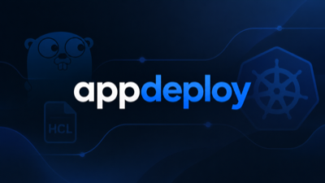

<p align="center">
  
</p>

# AppDeploy

AppDeploy lets you describe Kubernetes resources in one HCL file. `appd` turns that file into Kubernetes YAML and applies it to your cluster.

No Helm charts. No operator. No state file.

## Features

- **One file, many namespaces.** Declare `prod`, `staging`, and anything else in the same file. Blocks render into every namespace by default, or into one with `scope`.
- **Per-namespace overrides.** Define a ConfigMap or Secret once, then override individual values, add environment-specific values, or replace whole files for `staging`, `prod`, or any other namespace. The base definition stays in one place.
- **Config from several sources.** Build a ConfigMap from a `.env` file, inline values, inline file content, and real files in one block. A prefix filters `.env` keys, so one file can hold several environments.
- **Apps and services.** One `app` block creates a Deployment and, when you declare a port, a Service.
- **Stateful workloads.** One `stateful` block creates a StatefulSet, a headless Service, and its PersistentVolumeClaims.
- **Jobs and schedules.** `job` and `cron` blocks create Jobs and CronJobs.
- **Routes.** `route` creates an Ingress, with optional TLS and a Traefik CORS middleware. Different paths can target different service ports.
- **Mount anything.** Mount a volume, ConfigMap, or Secret into a workload with one `mount` block.
- **Volumes.** `volume` creates a PersistentVolumeClaim you can mount into workloads.
- **Escape hatch.** `manifest` accepts raw Kubernetes YAML for anything AppDeploy does not model.
- **Validated before apply.** Unknown references, duplicate names, unknown namespaces, and missing source files fail before anything reaches the cluster.
- **Preview before apply.** `appd run -o` prints the YAML without touching the cluster.
- **Server-side apply.** Applies with Kubernetes' native field management under the `appd` field manager.

## Install

```bash
go install github.com/ude-p/appdeploy/cmd/appd@latest
```

Requires Go 1.26 or newer. Prebuilt binaries for Linux and macOS (amd64 and arm64) are published on the releases page when a version is tagged.

## Quick start

Save this as `deploy.hcl`:

```hcl
namespace "prod" {}

app "api" {
  image    = "ghcr.io/example/api:1.4.0"
  replicas = 2

  port {
    service   = 80
    container = 3000
  }

  resources {
    cpu    = "500m"
    memory = "512Mi"
  }

  health {
    path = "/health"
    port = 3000
  }
}
```

Render it without touching a cluster:

```bash
appd run -f deploy.hcl -o
```

Apply it to the current kubeconfig context:

```bash
appd run -f deploy.hcl
```

The file must declare at least one `namespace`. `appd` creates the Namespace object as part of the apply.

`appd init` writes a larger starter template to `deploy.hcl`. It contains placeholders and example blocks; edit it before running.

## One file, many namespaces

A block without `scope` renders into every declared namespace. A block with `scope` renders only into that namespace.

`config`, `secret`, `app`, `stateful`, `job`, `cron`, and `route` accept `scope`. `namespace`, `volume`, and `manifest` do not.

The same block can also carry different values per namespace. The base definition is built first; scoped values are applied on top.

```hcl
namespace "prod" {}
namespace "staging" {}

config "app" {
  env {
    source = ".env"
    prefix = "CONFIG_"
  }

  LOG_LEVEL = "info"

  file "features.json" {
    source = "./features.json"
  }

  scope "staging" {
    env {
      source = ".env.staging"
      prefix = "CONFIG_"
    }

    LOG_LEVEL = "debug"

    file "features.json" {
      source = "./staging/features.json"
    }
  }
}

secret "app" {
  env {
    source = ".env"
    prefix = "SECRET_"
  }

  scope "staging" {
    env {
      source = ".env.staging"
      prefix = "SECRET_"
    }
  }
}

app "api" {
  image = "ghcr.io/example/api:1.4.0"

  env {
    config = config.app
    secret = secret.app
  }

  port {
    service = 80
  }
}
```

`prod` gets `CONFIG_*` values from `.env`, `LOG_LEVEL=info`, and `features.json`. `staging` gets everything from `prod` first, then `CONFIG_*` values from `.env.staging`, `LOG_LEVEL=debug`, and the staging `features.json` on top. The Secret follows the same pattern with `SECRET_*` values.

A scoped file replaces the base file with the same name. The `app` block does not change: it renders in both namespaces and picks up the right ConfigMap and Secret.

Run `appd run` for both namespaces, or `appd run -n staging` for one.

## How it works

`appd` reads `deploy.hcl`, validates it, renders the Kubernetes objects for each declared namespace, and applies them.

It is not an operator. It does not run inside your cluster, watch resources, or keep them in sync. It renders your file and sends it to Kubernetes once. If you remove a block from the file, delete the resource yourself. If another tool owns a field, the apply fails rather than overwriting it.

## Blocks at a glance

| Block | What it creates | Key fields |
|---|---|---|
| `namespace "name"` | a target namespace | — |
| `config "name"` | ConfigMap | `env`, inline values, `data`, `file`, `scope` |
| `secret "name"` | Secret | `env`, `file`, `scope` |
| `volume "name"` | PersistentVolumeClaim | `size`, `storage_class`, `access` |
| `app "name"` | Deployment and Service | `image`, `replicas`, `port`, `env`, `resources`, `mount`, `health` |
| `stateful "name"` | StatefulSet and headless Service | `image`, `port`, `volume`, `mount`, `env` |
| `job "name"` | Job | `image`, `command`, `args`, `retries`, `env`, `mount` |
| `cron "name"` | CronJob | `schedule`, plus the job fields |
| `route "name"` | Ingress and optional Traefik Middleware | `to`, `host`, `path`, `tls_secret`, `class_name`, `middleware` |
| `manifest "name"` | raw Kubernetes YAML | `yaml` |

Run `appd explain` for the topic list, or `appd explain <block>` for one block.

Secrets are sent to Kubernetes as plain text. Keep `appd run -o` output out of version control.

## Commands

| Command | Description |
|---|---|
| `appd init` | write a starter `deploy.hcl`; refuses to overwrite |
| `appd explain` | list the schema topics |
| `appd explain <topic>` | explain one block, for example `appd explain app` |
| `appd run` | render and apply |
| `appd run -o` | render to stdout |
| `appd run -f path` | use a different HCL file (default `deploy.hcl`) |
| `appd run -n name` | render only one declared namespace |
| `appd run --ctx name` | use a kubeconfig context |
| `appd run --kubeconfig path` | use a specific kubeconfig |

## Development

```bash
go test ./...
go build ./cmd/appd
go run ./cmd/appd explain
```
