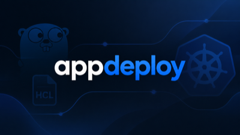

<p align="center">
  
</p>

# AppDeploy

AppDeploy lets you describe Kubernetes resources in one HCL file. `appd` turns that file into Kubernetes YAML and applies it to your cluster.

No Helm charts. No operator. No state file.

## Features

- **One file, many namespaces.** List `prod`, `staging`, and others in `namespaces`. Blocks render into all of them, or into one with `scope`.
- **Config next to the workload.** Declare `config` and `secret` inside a workload's `env` block; they become `<workload>-config` and `<workload>-secret`. Shared ones stay top-level and are referenced with `from_config` and `from_secret`. Build from a `.env` file, inline values, and files.
- **Per-namespace overrides.** Define a ConfigMap or Secret once, then override values or files for a namespace. The base definition stays in one place.
- **Apps and services.** One `app` block creates a Deployment and, with a port, a Service. The first port gets a TCP probe unless `health` supplies an HTTP path.
- **Pod metadata out of the box.** Every container gets `POD_NAME`, `POD_NAMESPACE`, `POD_IP`, `POD_UID`, `NODE_NAME`, and `HOST_IP`.
- **Defaults.** `defaults` sets app replicas and resources, and `node_selector` for every workload. Apps override them.
- **Stateful workloads.** One `stateful` block creates a StatefulSet, a headless Service, and its PersistentVolumeClaims.
- **Jobs and schedules.** `job` creates a Job; add `schedule` to create a CronJob.
- **Routes.** A `route` inside an `app` creates an Ingress, with optional TLS. `path` or `paths` selects URLs; `defaults` supplies the ingress class and common annotations.
- **Volumes and mounts.** `volume` creates a PersistentVolumeClaim; `mount` attaches a volume, ConfigMap, or Secret to a workload.
- **Escape hatch.** `manifest` accepts raw Kubernetes YAML for anything AppDeploy does not model.
- **Validated before apply.** Unknown references, duplicate names, unknown namespaces, and missing source files fail before anything reaches the cluster.
- **Preview before apply.** `appd run -o` prints the YAML without touching the cluster, with Secrets omitted.
- **GitOps output.** `appd run --kustomize ./apps` writes one kustomize directory per namespace, with Secrets encrypted by `sops` for Flux.
- **Server-side apply.** Applies with Kubernetes' native field management under the `appd` field manager.

## Install

```bash
go install github.com/ude-p/appdeploy/cmd/appd@latest
```

Requires Go 1.26 or newer. Prebuilt binaries for Linux and macOS (amd64 and arm64) are published on the releases page when a version is tagged.

## Quick start

Save this as `deploy.hcl`:

```hcl
namespaces = ["prod"]

app "api" {
  image    = "ghcr.io/example/api:1.4.0"
  replicas = 2

  port = 80

  resources {
    cpu    = "500m"
    memory = "512Mi"
  }

  health {
    path = "/health"
  }
}
```

Render it without touching a cluster:

```bash
appd run -f deploy.hcl -o
```

Apply it to the current kubeconfig context:

```bash
appd run -f deploy.hcl
```

The file must list at least one namespace in `namespaces`. `appd` creates the Namespace objects as part of the apply.

## More configuration

A fuller file with defaults, a persistent volume, a stateful workload, and both job types:

```hcl
namespaces = ["prod", "staging"]

defaults {
  replicas = 2

  node_selector = { "workload" = "general" }

  resources {
    cpu    = "250m"
    memory = "256Mi"
  }

  ingress_class = "traefik"

  ingress_annotations = {
    "cert-manager.io/cluster-issuer" = "letsencrypt"
  }
}

volume "uploads" {
  size          = "10Gi"
  storage_class = "longhorn"
  access        = "ReadWriteOnce"
}

app "api" {
  image = "ghcr.io/example/api:1.4.0"
  port  = 8000

  env {
    APP_ENV = "production"

    config {
      source = ".env"
      prefix = "CONFIG_"
    }

    secret {
      source = "./secrets/.env"
      prefix = "SECRET_"
    }
  }

  mount {
    volume = volume.uploads
    path   = "/data"
  }

  health {
    path = "/health"
  }

  route "api" {
    host  = "api.example.com"
    paths = ["/", "/api"]
    tls   = "api-tls"
  }
}

stateful "postgres" {
  image = "postgres:16"
  port  = 5432

  env {
    secret {
      source = "./secrets/.env"
      prefix = "SECRET_POSTGRES_"
    }
  }

  volume "data" {
    size          = "20Gi"
    storage_class = "longhorn"
    access        = "ReadWriteOnce"
    path          = "/var/lib/postgresql/data"
  }
}

job "migrate" {
  image = "ghcr.io/example/api:1.4.0"
  args  = ["migrate"]

  env {
    config {
      source = ".env"
      prefix = "CONFIG_"
    }
  }
}

job "cleanup" {
  image    = "ghcr.io/example/api:1.4.0"
  schedule = "0 2 * * *"
  args     = ["cleanup"]
}
```

`defaults` supplies values for every workload. `mount` attaches an existing volume, ConfigMap, or Secret. `health` is optional; without it, the first port gets a TCP probe. `schedule` turns a `job` into a CronJob.

## One file, many namespaces

A block without `scope` renders into every declared namespace. A block with `scope` renders only into that namespace.

`config`, `secret`, `app`, `stateful`, `job`, and `route` accept `scope`. `defaults`, `volume`, and `manifest` do not. Namespaces are listed at the top level, and a route defaults to the namespaces of the app it is declared in.

The same block can also carry different values per namespace. The base definition is built first; scoped values are applied on top.

```hcl
namespaces = ["prod", "staging"]

app "api" {
  image = "ghcr.io/example/api:1.4.0"

  env {
    APP_ENV = "production"

    config {
      source = ".env"
      prefix = "CONFIG_"

      LOG_LEVEL = "info"

      file "features.json" {
        source = "./features.json"
      }

      scope "staging" {
        source = ".env.staging"
        prefix = "CONFIG_"

        LOG_LEVEL = "debug"

        file "features.json" {
          source = "./staging/features.json"
        }
      }
    }

    secret {
      source = ".env"
      prefix = "SECRET_"

      scope "staging" {
        source = ".env.staging"
        prefix = "SECRET_"
      }
    }
  }

  port = 80
}
```

Every container gets `POD_NAME`, `POD_NAMESPACE`, `POD_IP`, `POD_UID`, `NODE_NAME`, and `HOST_IP` automatically.

The `config` block creates a ConfigMap named `api-config`; the `secret` block creates a Secret named `api-secret`. Both render in every namespace the app renders in.

`prod` gets `CONFIG_*` values from `.env`, `LOG_LEVEL=info`, and `features.json`. `staging` gets everything from `prod` first, then `CONFIG_*` values from `.env.staging`, `LOG_LEVEL=debug`, and the staging `features.json` on top. The Secret follows the same pattern with `SECRET_*` values. `APP_ENV` is a literal environment variable on the container, not part of the ConfigMap.

A scoped file replaces the base file with the same name.

When several workloads share one config or secret, declare it at the top level and reference it:

```hcl
config "shared-config" {
  source = ".env"
  prefix = "CONFIG_"
}

app "api" {
  env {
    from_config = config.shared-config
  }
}
```

Run `appd run` for both namespaces, or `appd run -n staging` for one.

## How it works

`appd` reads `deploy.hcl`, validates it, renders the Kubernetes objects for each declared namespace, and applies them.

It is not an operator. It does not run inside your cluster, watch resources, or keep them in sync. It renders your file and sends it to Kubernetes once. If you remove a block from the file, delete the resource yourself. If another tool owns a field, the apply fails rather than overwriting it.

## Blocks at a glance

| Block | What it creates | Key fields |
|---|---|---|
| `namespaces` | target namespaces | list of names |
| `defaults` | values shared by workloads | `replicas`, `node_selector`, `resources`, `ingress_class`, `ingress_annotations` |
| `config "name"` | ConfigMap | `source`, `prefix`, inline values, `file`, `scope` |
| `secret "name"` | Secret | `source`, `prefix`, `file`, `scope` |
| `volume "name"` | PersistentVolumeClaim | `size`, `storage_class`, `access` |
| `app "name"` | Deployment and Service | `image`, `replicas`, `port`, `ports`, `env`, `resources`, `mount`, `health`, `route` |
| `env` | environment on a workload | literal values, `config`, `secret`, `from_config`, `from_secret` |
| `stateful "name"` | StatefulSet and headless Service | `image`, `port`, `ports`, `volume`, `mount`, `env`, `health` |
| `job "name"` | Job, or CronJob with `schedule` | `image`, `command`, `args`, `retries`, `env`, `mount` |
| `route "name"` | Ingress for the enclosing app | `host`, `path`, `paths`, `port`, `tls`, `annotations` |
| `manifest "name"` | raw Kubernetes YAML | `yaml` |

Run `appd explain` for the topic list, or `appd explain <block>` for one block.

`appd run -o` omits Secret objects and prints a note to stderr. Secrets are sent to Kubernetes as plain text; keep the source HCL and `.env` files out of version control.

## GitOps output

`appd run --kustomize ./apps` writes files instead of applying:

```
apps/prod/
  kustomization.yaml
  namespace-prod.yaml
  configmap-api-config.yaml
  secret-api-secret.yaml
  deployment-api.yaml
  service-api.yaml
```

- One directory per rendered namespace, each with its own `kustomization.yaml`.
- Each object gets its own file: `<kind>-<name>.yaml`.
- Secrets are written as `data` and encrypted by `sops`; ConfigMaps stay plaintext.
- Raw `manifest` blocks go to `apps/_manifests/`.

appd calls the `sops` binary and does not manage keys. Put a `.sops.yaml` in the repository, or set the SOPS environment variables, so `sops` can find the key. If `sops` is missing, appd fails before writing anything.

Files are overwritten on each run. Files from removed resources are left on disk, but `kustomization.yaml` only references the current set.

## Commands

| Command | Description |
|---|---|
| `appd explain` | list the schema topics |
| `appd explain <topic>` | explain one block, for example `appd explain app` |
| `appd run` | render and apply |
| `appd run -o` | render to stdout; Secrets are omitted |
| `appd run --kustomize dir` | write kustomize files with SOPS-encrypted secrets |
| `appd run -f path` | use a different HCL file (default `deploy.hcl`) |
| `appd run -n name` | render only one declared namespace |
| `appd run --ctx name` | use a kubeconfig context |
| `appd run --kubeconfig path` | use a specific kubeconfig |

## Development

```bash
go test ./...
go build ./cmd/appd
go run ./cmd/appd explain
```
